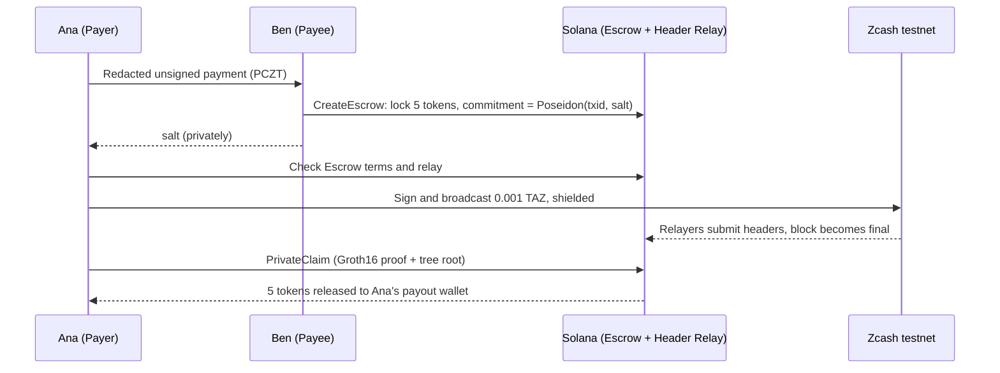

<div align="center">


# Zolar

**Act on shielded Zcash payments from Solana, without a custodian.**

[](https://github.com/AiltonSavio/zolar/actions/workflows/ci.yml)
[](LICENSE-MIT)


[Live dashboard](https://zolar-devnet.vercel.app) · [How it works](#how-a-swap-works) · [Try it](#run-a-testnet-swap) · [Glossary](GLOSSARY.md) · [ADRs](docs/adr)

</div>

Zolar is a Zcash light client on Solana, plus a trustless swap built on it: a Payer sends shielded ZEC, and once the payment is final a Solana program releases the Payee's SPL tokens. With a **Private Claim**, Solana never learns which Zcash transaction paid. Built for ZECATHON (Cross-Chain track).

| Part | What it does |
|---|---|
| **Header Relay** | Verifies Zcash headers on Solana (Equihash, difficulty adjustment, median time), follows the heaviest chain and records final blocks in a Merkle tree. |
| **Escrow** | Locks SPL tokens until a committed Zcash payment is final, or refunds them. |
| **Private Claim** | A locally made Groth16 proof that the payment is in a final block, without revealing it. |
| **Vending Machine** *(experimental)* | Sell tickets for ZEC with no per-sale service. See [`programs/vending`](programs/vending/README.md). |

> [!IMPORTANT]
> Zcash testnet and Solana devnet only. The programs are not audited, and Private Claims use a **single-party development key** whose creator could forge Claims.

## Live on devnet

| What | Solana devnet address |
|---|---|
| Header Relay program | `6F4o7Fphgz5MS4BZrqbE4NyaLUKiAprDNdYTxif4sg9D` |
| Escrow program | `HMew6N4iWjmWMbJBoK6WfQRucBt8ZfWpMadd9mpMtbML` |
| Vending program | `J9paKuXLpRr4rmWVp8vBZ6ZMwQhrTSk6w3Rmyv5JHFW5` |
| Relay following Zcash testnet (Finality Depth 10, demo only) | `C9eFRXy11aT8JqcyZPvEGqsor3pmrAyPDBmg6LCcGvWS` |
| Relay following Zcash mainnet (Finality Depth 20) | `2m1YC6pGTBpoKDHL5NQgDQDTewE7bYs4m6TdxkMG4Yhs` |

The [dashboard](https://zolar-devnet.vercel.app) shows both relays and Escrow activity live. A settled Private Claim swap: [CreateEscrow](https://explorer.solana.com/tx/4ufFWSDMb3oTDbs3Wp4DX93Y7Gb8qjhqYgZKYyHExnqqwfwBaqzSKEPvdvZAYZezMcrcfh2hNuoRaoREkUUdRdya?cluster=devnet) and [PrivateClaim](https://explorer.solana.com/tx/SDGSDwPtmWYDcz7VbVtP6edEdj28AWFgE5q942mxygyR1pCNZw1k6dxVyuCQjqtpBYk2uSQnf3ZMcVuUoNpYZRi?cluster=devnet); neither contains the Zcash transaction ID.

## How a swap works

Ana (Payer) buys 5 of Ben's (Payee) test tokens for 0.001 TAZ.



- **Private Claim** proves the payment is in a final block of the Escrow's height window. A **Reveal Claim** sends the transaction ID instead: cheaper, but public. `--private-only` Escrows refuse it.
- **Refunds:** if nobody claims, Ben can request a refund after expiry plus Finality Depth (or 24 hours), then a 15-minute window lets a late Claim still win.
- **Bond** *(optional)*: Ana locks tokens before claiming, forfeited on refund, so she cannot tie up Ben's tokens for free.

## Run a testnet swap

You play both sides, using faucet funds only. You need Rust 1.91.1, Solana CLI 2.3.11, Node 22, pnpm 10 and about 3 GB of free memory.

```sh
git clone https://github.com/AiltonSavio/zolar && cd zolar
cargo build --release --manifest-path cli/Cargo.toml    # about 10 minutes the first time

# zcash-devtool for the legacy protocol CLI tests, with explicit short expiry support
git clone https://github.com/zcash/zcash-devtool ../zcash-devtool
git -C ../zcash-devtool checkout 0b3436b
git -C ../zcash-devtool apply "$PWD/tools/zcash-devtool-0b3436b.patch"
cargo build --release --manifest-path ../zcash-devtool/Cargo.toml
export ZOLAR_DEVTOOL="$PWD/../zcash-devtool/target/release/zcash-devtool"
```

### Wallets and funds (once)

```sh
W=$HOME/zolar-wallets; mkdir -p "$W"

# Zcash testnet wallets
$ZOLAR_DEVTOOL wallet -w "$W/payer" init --name payer -i "$W/payer-key.txt" --network test
$ZOLAR_DEVTOOL wallet -w "$W/payee" init --name payee -i "$W/payee-key.txt" --network test
$ZOLAR_DEVTOOL wallet -w "$W/payee" list-addresses | awk '/Default Address:/ {print $3}' > "$W/payee.address"
$ZOLAR_DEVTOOL wallet -w "$W/payee" list-accounts | awk '/UFVK:/ {print $2}' > "$W/payee.ufvk"
$ZOLAR_DEVTOOL wallet -w "$W/payer" list-addresses | awk '/Default Address:/ {print $3}'   # fund this address

# Solana devnet keypairs and a test token
solana-keygen new --no-bip39-passphrase -o "$W/payee-sol.json"
solana-keygen new --no-bip39-passphrase -o "$W/payer-sol.json"
solana airdrop 2 "$(solana-keygen pubkey "$W/payee-sol.json")" -u devnet
solana airdrop 1 "$(solana-keygen pubkey "$W/payer-sol.json")" -u devnet
MINT=$(spl-token create-token -u devnet --decimals 6 --fee-payer "$W/payee-sol.json" --mint-authority "$W/payee-sol.json" | awk '/Address:/ {print $2}')
spl-token create-account "$MINT" -u devnet --owner "$W/payee-sol.json" --fee-payer "$W/payee-sol.json"
spl-token mint "$MINT" 100 -u devnet --mint-authority "$W/payee-sol.json" --fee-payer "$W/payee-sol.json" \
  --recipient-owner "$(solana-keygen pubkey "$W/payee-sol.json")"
```

Fund the Payer address from the [testnet faucet](https://zcashfaucet.jinolabs.xyz) and wait about 10 confirmations.

### The swap

```sh
export ZOLAR_ZCASH_WALLET="$W/payer" ZOLAR_ZCASH_IDENTITY="$W/payer-key.txt"
export ZOLAR_PAYER_KEYPAIR="$W/payer-sol.json" ZOLAR_PAYEE_KEYPAIR="$W/payee-sol.json"
export PAYEE_UA_FILE="$W/payee.address" PAYEE_UFVK_FILE="$W/payee.ufvk" MINT

# Reveal Claim (no circuit files needed)
PRIVATE_ONLY=0 CLAIM=reveal scripts/private-swap.sh

# Private Claim: download the proving files the devnet Escrow verifies (about 490 MB)
cargo build --release -p dev-groth16
pnpm --dir circuits install
mkdir -p "$HOME/zolar-data/build" && cd "$HOME/zolar-data/build"
gh release download private-claim-d8-dev -R AiltonSavio/zolar
sha256sum -c SHA256SUMS && tar -xf d8.tar && cd -
export ZOLAR_DATA="$HOME/zolar-data"
scripts/private-swap.sh
```

Each run takes about 8 minutes: create the payment, lock the Escrow, pay, wait for finality, prove, claim, then check that the transaction ID is absent from Solana. Run `zolar-payer --help` and `zolar-payee --help` for refunds and other commands.

> [!CAUTION]
> An unredacted PCZT contains the Payer's full viewing key. Only ever share `created.payee.pczt`.

## Build a checkout

- **Escrow checkout:** the [SDK](sdk/README.md) connects a shop page to the Payee's `zolar-merchant` and the Payer's existing [Zkool](https://github.com/hhanh00/zkool2) testnet wallet. Zkool signs the payment; `zolar-connect`, a local connector with no Zcash keys, checks the Escrow, broadcasts the signed payment and makes the Private Claim. Two shop checkouts paid this way settled: [3QanzC…](https://explorer.solana.com/tx/3QanzC4oqbJKbmddUtUooNQyv2eopppBvDqmAQdiwrQy8N2tWioVKXzNCPRCQBtKyERAxdy88HKDT6fSihS8mkGa?cluster=devnet) and [4Ap2GN…](https://explorer.solana.com/tx/4Ap2GNtcmVmyvDmNHN7NKrLSMmYF25NsE7uPPcUhFtma8B8H8yA99ct63wNLtK2DvUbsACJ6fqMSweYfMBZ4DBcV?cluster=devnet). Wallet Escrows allow an expiry up to 144 blocks ahead; see [ADR 0006](docs/adr/0006-external-wallets-keep-their-prepared-payment-effects.md) and the [demo shop](shop/README.md).
- **Vending checkout** *(experimental)*: the Payee sets up stock once and a keyless prover makes the Payment Proof. A Claim with a real proof is not yet verified. See [`programs/vending`](programs/vending/README.md).

## What each party learns

| Who | Learns | Does not learn |
|---|---|---|
| Anyone reading Solana | Escrow terms, and when it is claimed or refunded | With a Private Claim: the transaction ID, its block or the salt |
| Shop page, after wallet connection | The Zkool account and Zcash address, the Solana receiving address, item, price and checkout stages | Wallet credentials, the signed Zcash transaction, its ID or the salt |
| Payee | The transaction ID, and the amount and memo of its own output | The Payer's viewing key, other notes or change |
| Zcash peers | Which recent blocks were fetched | Any transaction ID |
| Payer's light wallet server | The whole payment, and the Payer's IP | Anything on Solana |
| Solana RPC node | Transactions sent through it, with the sender's IP | The Zcash transaction behind a Private Claim |

A Private Claim hides *which* transaction paid, not *that* a swap happened: on a quiet chain, the Escrow's height window (20 to 30 blocks for a CLI swap, up to 144 for a wallet checkout) leaves few candidates.

## Security model

Zolar trusts the relay's **Checkpoint**, **Zcash proof of work** over Finality Depth, the **Groth16 setup** (a development key today) and Solana. The programs enforce, with tests in `crates/relay-tests` and `crates/escrow-tests`:

- Every header passes Equihash, its target, the difficulty adjustment, the median-time rule and a known parent.
- A reorg deeper than Finality Depth **Halts** the relay for good; Escrows then refund through the 24-hour backstop.
- A Claim pays only the Escrow's payout wallet, works once, and needs a recent root from a running relay.
- A refund cannot beat an honest Claim, thanks to the 15-minute window.

## Compute units

| Operation | Compute units |
|---|---|
| Relay one header | 4 transactions, heaviest about 1.2M of the 1.4M cap |
| `CreateEscrow` / `RevealClaim` / `PrivateClaim` | 5.5k / 25k / 95k |
| `DepositBond` / `RequestRefund` / `Refund` | 1.8k / 0.6k / 3.2k |

Keeping a relay at the tip costs about 0.07 SOL a day on testnet and 0.02 SOL a day on mainnet.

## Limitations

- Private Claims use a single-party development key. The [ceremony tooling](circuits/ceremony/README.md) is ready; the ceremony runs after the hackathon.
- Devnet only, unaudited, and the testnet Finality Depth of 10 is demo only.
- A Private Claim needs a payment block of at most 256 transactions, about 2 GiB of memory and a minute of proving.
- The mainnet relay predates NU7 and needs a new Checkpoint once NU7 activates.
- Relayers are not rewarded; the demo relays are run by the author.

## Repository layout

| Path | Contents |
|---|---|
| `programs/` | Header Relay, Escrow and Vending programs (Pinocchio) |
| `crates/` | Header verification, relayer, claim and PCZT helpers, vending prover, LiteSVM tests |
| `cli/` | `zolar-connect`, `zolar-payer`, `zolar-payee`, `zolar-merchant`, and the legacy `zolar-wallet` helper |
| [`circuits/`](circuits/README.md) | Private Claim circuit and ceremony tooling |
| `clients/` | Codama definitions and generated clients |
| [`sdk/`](sdk/README.md), [`shop/`](shop/README.md), [`dashboard/`](dashboard/README.md) | Checkout SDK, demo shop, read-only dashboard |

## Development

```sh
cargo fmt --all --check
cargo clippy --workspace --all-targets -- -D warnings
cargo build-sbf --manifest-path programs/escrow/Cargo.toml   # likewise header-relay and vending
cargo test --workspace                                        # about 5 minutes
cargo test --manifest-path cli/Cargo.toml                     # CLI and Zkool connector
pnpm --dir clients/codama install && pnpm --dir clients/codama generate   # regenerate clients
```

`programs/*`, `cli` and some crates are separate Cargo workspaces; [CI](.github/workflows/ci.yml) runs the full set of checks.

## Prior art

- **Skyhook** (Strahn Cryptography) introduced swaps keyed to a Zcash transaction ID on Ethereum. Zolar credits its design, and adds full on-chain difficulty checks, contiguous relaying and Private Claims.
- **ZULU** (Starknet) relayed Zcash headers with on-chain Equihash. Zolar brings this to Solana, where a header needs several transactions.
