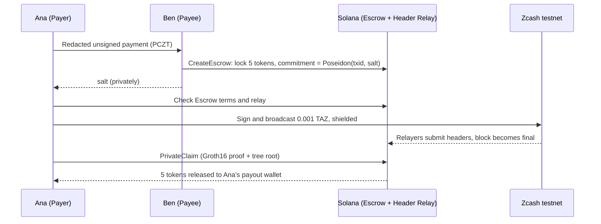

<div align="center">


# Zolar

**Act on shielded Zcash payments from Solana, without a custodian.**

[](https://github.com/AiltonSavio/zolar/actions/workflows/ci.yml)
[](LICENSE-MIT)


[Live dashboard](https://zolar-devnet.vercel.app) · [How a swap works](#how-a-swap-works) · [Run a testnet swap](#run-a-testnet-swap) · [Glossary](GLOSSARY.md) · [Design decisions](docs/adr)

</div>

Zolar is a Zcash light client that runs on Solana, plus a trustless swap built on top of it. A Payer sends shielded ZEC; once the payment is final on Zcash, a Solana program releases the Payee's SPL tokens to the Payer. With a **Private Claim**, the Payer proves the payment on their own machine and Solana never learns which Zcash transaction paid.

Built for ZECATHON (Cross-Chain track).

| Part | What it does |
|---|---|
| **Header Relay** | Zcash block headers verified on Solana. Anyone can submit headers; the program checks Equihash proof of work, the difficulty adjustment and the median-time rule on-chain, follows the chain with the most work, and records every final block in a Poseidon Merkle tree (the Final Block Tree). |
| **Escrow** | A Payee locks SPL tokens against a commitment to a Zcash transaction. The Payer pays shielded ZEC, waits for finality and claims. Unclaimed Escrows are refunded. |
| **Private Claim** | A Groth16 proof, made locally, that the committed payment is in a final block. Solana receives 256 bytes of proof and a tree root, never the transaction ID. |
| **Vending Machine** *(experimental)* | A Payee sets up ticket stock once; Payers reserve, pay and claim with an SP1 Payment Proof. See [`programs/vending`](programs/vending/README.md). |

> [!IMPORTANT]
> Zolar runs on **Zcash testnet and Solana devnet only**. The programs are not audited, and Private Claims use a **single-party development key**: whoever generated it could forge a Private Claim. See [Limitations](#limitations).

## Live on devnet

The [dashboard](https://zolar-devnet.vercel.app) shows both relays, open Escrows and Claims as they land. It is read-only and holds no keys.

| What | Solana devnet address |
|---|---|
| Header Relay program | `6F4o7Fphgz5MS4BZrqbE4NyaLUKiAprDNdYTxif4sg9D` |
| Escrow program | `HMew6N4iWjmWMbJBoK6WfQRucBt8ZfWpMadd9mpMtbML` |
| Vending program | `J9paKuXLpRr4rmWVp8vBZ6ZMwQhrTSk6w3Rmyv5JHFW5` |
| Relay following Zcash testnet (NU7), Finality Depth 10, demo only | `C9eFRXy11aT8JqcyZPvEGqsor3pmrAyPDBmg6LCcGvWS` |
| Relay following Zcash mainnet, Finality Depth 20 | `2m1YC6pGTBpoKDHL5NQgDQDTewE7bYs4m6TdxkMG4Yhs` |

`zolar-relayer` keeps both relays at the tip. The mainnet relay lives on Solana devnet: it verifies real mainnet headers at full mainnet difficulty, but it is not a Solana mainnet deployment.

**A settled Private Claim swap.** Zcash testnet payment `3dbb300e…2e814` was claimed from Escrow [`AKbiHejA…AhUB`](https://explorer.solana.com/address/AKbiHejAGJ51KqvkBQxvhhKKaAEdudhznrnWxeFJAhUB?cluster=devnet) ([CreateEscrow](https://explorer.solana.com/tx/4ufFWSDMb3oTDbs3Wp4DX93Y7Gb8qjhqYgZKYyHExnqqwfwBaqzSKEPvdvZAYZezMcrcfh2hNuoRaoREkUUdRdya?cluster=devnet), [PrivateClaim](https://explorer.solana.com/tx/SDGSDwPtmWYDcz7VbVtP6edEdj28AWFgE5q942mxygyR1pCNZw1k6dxVyuCQjqtpBYk2uSQnf3ZMcVuUoNpYZRi?cluster=devnet)). `scripts/check-txid-absent.sh` finds no form of the Zcash transaction ID in either Solana transaction. The same script does find it in a Reveal Claim swap, so the check is not vacuous.

## How a swap works

Ana (the Payer) buys 5 of Ben's (the Payee's) test tokens for 0.001 TAZ (100,000 zatoshi), the defaults of the swap script below.



1. **Ana** builds an unsigned Zcash transaction (a PCZT) paying Ben, with Ben's challenge text in the memo. Its transaction ID is known before signing.
2. **Ben** receives a redacted copy (`created.payee.pczt`), decrypts his output with his viewing key, checks amount and memo, and creates the Escrow: the 5 tokens in a vault, Ana's payout address, an expiry height and the Payment Commitment `Poseidon(txid, salt)`. The salt goes to Ana privately.
3. **Ana** checks the Escrow against the agreed terms and the relay against the Zcash chain, then signs and broadcasts the payment.
4. Once Finality Depth blocks follow the payment's block, the relay appends that block to the Final Block Tree.
5. **Ana** claims, in one of two ways:
   - **Private Claim**: proves locally that some transaction in a final block of the Escrow's height window hashes with the salt to the commitment.
   - **Reveal Claim**: sends the transaction ID, salt and Merkle paths. Cheaper, but it publishes the transaction ID. `zolar-payee create-escrow --private-only` makes an Escrow that refuses it.
6. If no valid Claim arrives, Ben requests a refund once the tip passes expiry plus Finality Depth (or 24 hours after creation), then takes the tokens back after a 15-minute window in which a late Claim still wins.

An optional **Bond** makes Ana lock tokens before a Claim can settle. It returns with the Claim and goes to Ben on a refund, so Ana cannot hold Ben's tokens hostage for free.

## Run a testnet swap

This runs one swap of testnet ZEC (TAZ) for a devnet token on your machine, with you playing both Payer and Payee. It costs only faucet funds.

### Prerequisites

- Rust 1.91.1 (selected by `rust-toolchain.toml`), Solana CLI 2.3.11 (includes `spl-token`), Node 22 and pnpm 10
- About 3 GB of free memory for the builds and 2 GiB for a Private Claim proof

```sh
git clone https://github.com/AiltonSavio/zolar && cd zolar
cargo build --release --manifest-path cli/Cargo.toml    # zolar-payer and zolar-payee; about 10 minutes the first time

# zcash-devtool, patched to set a PCZT's expiry height (the Escrow refuses expiries over 20 blocks ahead)
git clone https://github.com/zcash/zcash-devtool ../zcash-devtool
git -C ../zcash-devtool checkout 0b3436b
git -C ../zcash-devtool apply "$PWD/tools/zcash-devtool-0b3436b.patch"
cargo build --release --manifest-path ../zcash-devtool/Cargo.toml
export ZOLAR_DEVTOOL="$PWD/../zcash-devtool/target/release/zcash-devtool"
```

### Wallets and funds (once)

Create a Zcash testnet wallet for each side. The Payer's wallet spends; the Payee's viewing key checks the payment.

```sh
W=$HOME/zolar-wallets; mkdir -p "$W"
$ZOLAR_DEVTOOL wallet -w "$W/payer" init --name payer -i "$W/payer-key.txt" --network test
$ZOLAR_DEVTOOL wallet -w "$W/payee" init --name payee -i "$W/payee-key.txt" --network test
$ZOLAR_DEVTOOL wallet -w "$W/payee" list-addresses | awk '/Default Address:/ {print $3}' > "$W/payee.address"
$ZOLAR_DEVTOOL wallet -w "$W/payee" list-accounts | awk '/UFVK:/ {print $2}' > "$W/payee.ufvk"
$ZOLAR_DEVTOOL wallet -w "$W/payer" list-addresses | awk '/Default Address:/ {print $3}'   # fund this address
```

Request TAZ for the Payer address from the [jinolabs testnet faucet](https://zcashfaucet.jinolabs.xyz) (0.1 TAZ per address per day; a swap uses 0.001 TAZ plus fees), then wait about 10 confirmations.

Then create two Solana devnet keypairs and a test token standing in for USDC:

```sh
solana-keygen new --no-bip39-passphrase -o "$W/payee-sol.json"
solana-keygen new --no-bip39-passphrase -o "$W/payer-sol.json"
solana airdrop 2 "$(solana-keygen pubkey "$W/payee-sol.json")" -u devnet   # or https://faucet.solana.com
solana airdrop 1 "$(solana-keygen pubkey "$W/payer-sol.json")" -u devnet
MINT=$(spl-token create-token -u devnet --decimals 6 --fee-payer "$W/payee-sol.json" --mint-authority "$W/payee-sol.json" | awk '/Address:/ {print $2}')
spl-token create-account "$MINT" -u devnet --owner "$W/payee-sol.json" --fee-payer "$W/payee-sol.json"
spl-token mint "$MINT" 100 -u devnet --mint-authority "$W/payee-sol.json" --fee-payer "$W/payee-sol.json" \
  --recipient-owner "$(solana-keygen pubkey "$W/payee-sol.json")"
```

> [!NOTE]
> This token has no freeze authority. The Payer refuses a mint that has one (Circle's devnet USDC does) unless run with `--accept-freeze-authority`.

### The swap

```sh
export ZOLAR_ZCASH_WALLET="$W/payer" ZOLAR_ZCASH_IDENTITY="$W/payer-key.txt"
export ZOLAR_PAYER_KEYPAIR="$W/payer-sol.json" ZOLAR_PAYEE_KEYPAIR="$W/payee-sol.json"
export PAYEE_UA_FILE="$W/payee.address" PAYEE_UFVK_FILE="$W/payee.ufvk" MINT
```

**Reveal Claim** needs no circuit files:

```sh
PRIVATE_ONLY=0 CLAIM=reveal scripts/private-swap.sh     # about 8 minutes; the last step finds the txid on Solana, as expected
```

**Private Claim** must use the proving key the devnet Escrow verifies, so download the circuit files from the [`private-claim-d8-dev` release](https://github.com/AiltonSavio/zolar/releases/tag/private-claim-d8-dev) rather than building your own:

```sh
cargo build --release -p dev-groth16          # the local prover
pnpm --dir circuits install                    # snarkjs, for the witness
mkdir -p "$HOME/zolar-data/build" && cd "$HOME/zolar-data/build"
gh release download private-claim-d8-dev -R AiltonSavio/zolar   # wasm, R1CS, proving key; about 490 MB
sha256sum -c SHA256SUMS && tar -xf d8.tar && cd -
export ZOLAR_DATA="$HOME/zolar-data"
scripts/private-swap.sh                        # about 8 minutes: pay, wait for finality, prove (about 1 minute), claim, check
```

The payment expires 18 blocks (about 8 minutes) after the PCZT is made, so the script runs these steps back to back:

1. `zolar-payer create-pczt` builds the unsigned payment, its transaction ID and the redacted copy for the Payee.
2. `zolar-payee create-escrow` decrypts the redacted PCZT with the viewing key, checks amount and memo, and locks the tokens.
3. `zolar-payer pay` checks the Escrow and the relay, proves and signs, and broadcasts.
4. `zolar-payer private-claim` (or `claim`) waits for finality, fetches the block over Zcash P2P, proves locally and claims.
5. `scripts/check-txid-absent.sh` searches every Solana transaction of the Escrow for the Zcash transaction ID. Exit 0 means no form of it was found.

> [!CAUTION]
> An unredacted PCZT carries the Payer's full viewing key, note values and change. Only ever hand the Payee `created.payee.pczt`.

Other useful commands: `zolar-payer --help` and `zolar-payee --help` list every option, `zolar-payee refund --escrow <address> --wait` takes an unclaimed Escrow back, and `zolar-payer verify-tree` checks that the relay's Final Block Tree matches the headers of live Zcash peers.

## Build a checkout

Two checkout flows sit on top of the relay:

- **Escrow checkout.** [`@zolar/sdk`](sdk/README.md) connects a shop page to `zolar-merchant` (the Payee's service, which creates private-only Escrows per order) and `zolar-wallet` (a local helper standing in for Zcash wallet support, which pays and makes the Private Claim). The [demo shop](shop/README.md) sells tickets for a fictional event this way.
- **Vending checkout** *(experimental)*. The Payee configures stock once and runs nothing per sale; the Payer reserves on Solana, pays from a Zcash wallet, and a keyless prover makes an SP1 Payment Proof for the Claim. Sales are public through a Shop Viewing Key. Setup, a real payment and SP1 execution are verified on devnet; a Claim mint with a real Groth16 proof is not. See [`programs/vending`](programs/vending/README.md).

## What each party learns

| Who | Learns | Does not learn |
|---|---|---|
| Anyone reading Solana | The Escrow: Payee, payout wallet, mint, amount, creation tip, expiry height, commitment; when it is claimed or refunded | With a Private Claim: the Zcash transaction ID, its block, its position, the salt |
| Anyone reading Solana, Reveal Claim | Also the transaction ID and salt, linking the Zcash payment to the Escrow | |
| Payee | The transaction ID, and the amount and memo of its own output | The Payer's viewing key, other notes, the values of the notes spent, or the change |
| Zcash P2P peers asked for blocks | That some node asked for headers since the Checkpoint and for blocks of a recent window, each block by hash from a random peer | Any transaction ID |
| The Payer's light wallet server | The whole payment, and the Payer's IP address | Anything on Solana |
| The Solana RPC node | Every Solana transaction sent through it, with the sender's IP address | The Zcash transaction behind a Private Claim |
| Block explorers | Nothing: neither CLI queries an explorer | |

Limits on that privacy:

- The Escrow's height window covers about 20 to 30 blocks, and a Claim lands minutes after its block is final. On a quiet chain that narrows the candidates to a few transactions. Zolar hides *which* transaction paid, not *that* a swap happened.
- Someone watching all of the Payer's network traffic sees the last block fetched before the Claim (the payment's block) and the broadcast to the light wallet server.
- The Payee's challenge memo must be new for every trade; it is what stops an old payment from being presented again.

## Security model

Zolar trusts:

- **The Checkpoint**, the block a relay starts from. Anyone can compare it with a Zcash node; the relay's address is a digest of it.
- **Zcash proof of work over Finality Depth.** A Claim is as safe as a reorganisation deeper than Finality Depth is unlikely. Testnet relays use 10 blocks (demo only); the mainnet relay uses 20 (about 25 minutes).
- **The Groth16 setup** for Private Claims, today a single-party development key.
- Solana itself, and the Zolar programs, which are not audited.

What the programs enforce, each with tests in `crates/relay-tests` and `crates/escrow-tests`:

- A header needs valid Equihash (200,9), a hash under its target, the target the difficulty adjustment requires, a timestamp above the median of the last 11 blocks, and a known parent. Forged headers are rejected, and recorded mainnet headers replay at full mainnet difficulty.
- The relay follows the chain with the most work. A reorganisation deeper than Finality Depth **Halts** it: no more headers, no more Claims, and Escrows refund through the 24-hour backstop. A Halt is permanent; a new relay starts from a new Checkpoint.
- A Claim pays only the payout wallet named in the Escrow, so a copied or front-run Claim still pays the Payer. A second Claim fails. A Claim needs a block from the Escrow's height window, a root among the relay's last 128, and a running relay.
- A refund cannot beat an honest Claim: it needs the tip above expiry plus Finality Depth (or the 24-hour backstop), then a 15-minute window in which a Claim still wins.
- The Payer's CLI refuses an Escrow whose terms differ from what was agreed, a vault with a delegate or close authority, a mint with a freeze authority (unless accepted), a relay of another Zcash network or whose Final Block Tree differs from live peers', and a private-only Escrow (unless accepted).

## Compute units

Measured in LiteSVM and on devnet.

| Operation | Compute units |
|---|---|
| Relaying one header | 4 transactions; the two heaviest about 1.08M and 1.2M of the 1.4M cap |
| Equihash (200,9) verification | 2.17M in total, split into two steps (a stock implementation measured 4.46M) |
| `AcceptHeader` | 47k to 65k; up to 120k when it also finalises a block into the tree |
| `CreateEscrow` / `RevealClaim` | 5.5k / 25k |
| `PrivateClaim` (Groth16 over BN254) | 95k |
| `DepositBond` / `RequestRefund` / `Refund` | 1.8k / 0.6k / 3.2k |

Keeping a relay at the tip costs 20,000 lamports per header in fees: about 0.07 SOL a day for the testnet relay and 0.02 SOL a day for mainnet. The header buffer's rent is returned after each header.

## Limitations

- **The Private Claim key is a single-party development key.** That is acceptable for a devnet demo with test tokens, not for real value. The phase-2 ceremony tooling is ready and rehearsed in [`circuits/ceremony`](circuits/ceremony/README.md); the ceremony itself will run after the hackathon with outside contributors (one honest contributor is enough).
- Devnet only, and the programs are not audited.
- The testnet Finality Depth of 10 is for the demo only.
- The mainnet relay's Checkpoint predates NU7 on mainnet; once NU7 activates, a new relay is needed.
- A Private Claim needs the payment's block to hold at most 256 transactions, about 2 GiB of memory and about a minute of proving.
- No Relayer rewards: anyone can relay, and the demo relays are run by the author.
- A flood of about 250 valid sibling blocks could make the relay's store refuse an honest fork block. Each one costs real proof of work.
- The Vending Machine's Claim mint with a real Payment Proof is unverified.

## Repository layout

| Path | Contents |
|---|---|
| [`programs/header-relay`](programs/header-relay) | Header Relay program (Pinocchio, own workspace) |
| [`programs/escrow`](programs/escrow) | Escrow program (Pinocchio, own workspace) |
| [`programs/vending`](programs/vending/README.md) | Vending Machine program (Pinocchio, own workspace) |
| [`crates/zcash-header`](crates/zcash-header) | `no_std` header parsing, Equihash and difficulty rules, shared on- and off-chain |
| [`crates/header-relay-interface`](crates/header-relay-interface) | Dependency-free `RelayView` for programs that trust a relay |
| [`crates/relayer`](crates/relayer) | `zolar-relayer`: follows Zcash peers over P2P and keeps a relay at the tip |
| [`crates/zolar-claim`](crates/zolar-claim), [`crates/zolar-pczt`](crates/zolar-pczt) | Payment Commitment, Merkle paths, Private Claim witness; PCZT transaction ID, decryption and redaction |
| [`crates/vending-*`](crates/vending-guest/README.md), [`crates/sp1-solana-v6`](crates/sp1-solana-v6/README.md) | Vending shared types, SP1 guest, keyless prover and the SP1 verifier |
| [`cli`](cli) | `zolar-payer`, `zolar-payee`, `zolar-merchant` and `zolar-wallet` (own workspace) |
| [`circuits`](circuits/README.md) | Private Claim circuit (circom, Groth16), proving scripts and ceremony tooling |
| [`clients`](clients) | Codama definitions and the generated Rust and JS clients |
| [`sdk`](sdk/README.md), [`shop`](shop/README.md), [`dashboard`](dashboard/README.md) | TypeScript checkout SDK, demo shop and read-only dashboard |
| `crates/*-tests` | LiteSVM tests that drive the programs through the generated clients |
| `scripts`, `tools` | Fixture export, forged headers, the swap script and the transaction ID search |

## Development

Rust builds are memory hungry; on a small machine cap them, for example with `CARGO_BUILD_JOBS=2`.

```sh
# Rust: format, lint, build the programs, test
cargo fmt --all --check
cargo clippy --workspace --all-targets -- -D warnings
cargo build-sbf --manifest-path programs/header-relay/Cargo.toml
cargo build-sbf --manifest-path programs/escrow/Cargo.toml
cargo build-sbf --manifest-path programs/vending/Cargo.toml
cargo test --workspace                       # LiteSVM tests; about 5 minutes
cargo test --manifest-path cli/Cargo.toml

# Generated clients (CI fails if they drift)
pnpm --dir clients/codama install && pnpm --dir clients/codama generate && cargo fmt --all

# TypeScript (the SDK depends on the built vending client)
pnpm --dir clients/vending-js install && pnpm --dir clients/vending-js build
pnpm --dir sdk install && pnpm --dir sdk typecheck && pnpm --dir sdk test && pnpm --dir sdk build
pnpm --dir shop install && pnpm --dir shop lint && pnpm --dir shop test && pnpm --dir shop build
pnpm --dir dashboard install && pnpm --dir dashboard lint && pnpm --dir dashboard test && pnpm --dir dashboard build

# Privacy check
python3 -I scripts/test_check_txid_absent.py
```

`programs/*`, `cli`, `crates/zolar-pczt` and the vending crates are separate Cargo workspaces (the SBF programs build with an older toolchain); run `cargo fmt --check` and `cargo clippy --all-targets -- -D warnings` inside each. [CI](.github/workflows/ci.yml) runs the full set, including the circuit tests. Vending-specific checks are in [`programs/vending`](programs/vending/README.md#verify-vending-locally).

## Prior art and credit

- **Skyhook** (Strahn Cryptography) introduced swaps keyed to a ZIP 244 transaction ID, on Ethereum and Base, with Equihash verified on the EVM and FlyClient-style finality. Per its proposal, it enforces a trusted difficulty floor rather than the difficulty adjustment, and the recipient's note data is visible on-chain. Zolar's swap design credits it. Zolar differs in enforcing the full difficulty adjustment on-chain, relaying contiguously instead of sampling, and the Private Claim, which reveals neither the recipient nor the transaction.
- **ZULU** (Starknet, Zypherpunk 2025) relayed Zcash headers with on-chain Equihash and proved transaction inclusion. Zolar brings the idea to Solana, where a header fits neither one transaction nor one compute budget.
